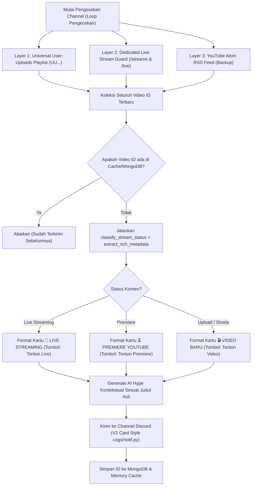

# 📋 MASTER PLAN TUNGGAL: PENYELARASAN NOTIFIKASI & ENGINE DETEKSI UNIVERSAL KONTEN YOUTUBE (VIDEO, SHORTS, LIVE, PREMIERE)

> **Catatan Penting (Prinsip Tunggal):** File ini ([PLAN_NOTIF_AI_DAN_YT_CHECKER.md](file:///c:/Users/Administrator/Downloads/rtmbot/PLAN_NOTIF_AI_DAN_YT_CHECKER.md)) adalah **SATU-SATUNYA file rencana teknis** untuk seluruh pembaruan sistem YouTube Checker dan Notifikasi AI. Tidak akan ada file plan lain yang dibuat. Seluruh rancangan, arsitektur, dan checklist berada di sini.

---

## DAFTAR ISI
1. [Bedah Komparasi Visual: Foto 1 (Gagal) vs Foto 2 (Input) vs Foto 3 (Benchmark Sempurna)](#1-bedah-komparasi-visual-foto-1-gagal-vs-foto-2-input-vs-foto-3-benchmark-sempurna)
2. [Analisis Akar Masalah Teknis (Root Cause Analysis)](#2-analisis-akar-masalah-teknis-root-cause-analysis)
   - [Masalah A: Kenapa Judul & Channel Menjadi Default di Foto 1?](#masalah-a-kenapa-judul--channel-menjadi-default-di-foto-1)
   - [Masalah B: Kenapa AI Mengarang Bebas Soal Badut Mall?](#masalah-b-kenapa-ai-mengarang-bebas-soal-badut-mall)
   - [Masalah C: Perbedaan Struktur Discord V2 Card](#masalah-c-perbedaan-struktur-discord-v2-card)
   - [Masalah D: Keterbatasan Tab `/videos` (Tidak Bisa Mendeteksi Live & Shorts)](#masalah-d-keterbatasan-tab-videos-tidak-bisa-mendeteksi-live--shorts)
3. [Arsitektur Engine Deteksi Universal: "Triple-Layer Detector"](#3-arsitektur-engine-deteksi-universal-triple-layer-detector)
   - [Layer 1: Universal "UU" Playlist (Video, Shorts, dan Live Sekaligus)](#layer-1-universal-uu-playlist-penemuan-utama)
   - [Layer 2: Live Stream Guard (`/streams` & `/live`)](#layer-2-live-stream-guard-streams--live)
   - [Layer 3: YouTube Atom RSS Feed (Backup Sekunder)](#layer-3-atom-rss-feed-jaring-pengaman-sekunder)
4. [Arsitektur Ekstraksi Metadata Andal (Belajar dari `cogs/notif.py`)](#4-arsitektur-ekstraksi-metadata-andal-belajar-dari-cogsnotifpy)
5. [Spesifikasi Tampilan Discord V2 Card (Penyelarasan 1:1 dengan Foto 3)](#5-spesifikasi-tampilan-discord-v2-card-penyelarasan-11-dengan-foto-3)
6. [Spesifikasi AI Copywriting Kontekstual](#6-spesifikasi-ai-copywriting-kontekstual)
7. [Arsitektur Database MongoDB & Sinkronisasi Cache](#7-arsitektur-database-mongodb--sinkronisasi-cache)
8. [Rencana Kode Teknis & Diff Implementasi](#8-rencana-kode-teknis--diff-implementasi)
9. [Checklist Validasi & Status Persetujuan](#9-checklist-validasi--status-persetujuan)
10. [Rencana Penyempurnaan Fase 2: Deteksi Live, Deskripsi Konten, Reduksi Delay, & 1 Pesan Tunggal](#10-rencana-penyempurnaan-fase-2-deteksi-live-deskripsi-konten-reduksi-delay--1-pesan-tunggal)

---

## 1. BEDAH KOMPARASI VISUAL: FOTO 1 (GAGAL) VS FOTO 2 (INPUT) VS FOTO 3 (BENCHMARK SEMPURNA)

Berdasarkan 3 tangkapan layar yang diberikan pengguna saat menguji perintah `!yttest https://youtu.be/bYXjikrHBME`:

```
┌────────────────────────────────────────────────────────────────────────────────────────┐
│ KOMPARASI ELEMEN VISUAL                                                                │
├────────────────────┬─────────────────────────────┬─────────────────────────────────────┤
│ Elemen Komponen    │ Foto 1 (yt_checker_test.py) │ Foto 3 (cogs/notif.py - YANG BENAR) │
├────────────────────┼─────────────────────────────┼─────────────────────────────────────┤
│ 1. AI Hype Mention │ Halusinasi topik:           │ Kontekstual akurat:                 │
│                    │ "video baru kita yang       │ "RnBoyz baru upload video nih,      │
│                    │ Reaksi Pas Warga Ketemu     │ katanya sih ada yang 'lincah        │
│                    │ Badut Random di Mall"       │ lincah bgt' bareng Mahalini!"       │
├────────────────────┼─────────────────────────────┼─────────────────────────────────────┤
│ 2. Header Judul    │ `# 🎬 VIDEO BARU •          │ (Tidak ada header kaku)             │
│    Kartu           │ YouTube Channel` (Kaku)     │                                     │
├────────────────────┼─────────────────────────────┼─────────────────────────────────────┤
│ 3. Judul Konten    │ Teks link: `Video YouTube`  │ Judul asli warna biru tebal:        │
│                    │ (Gagal ambil judul asli)    │ `# [lincah lincah bgt??!!! ...](url)│
├────────────────────┼─────────────────────────────┼─────────────────────────────────────┤
│ 4. Subtitle Link   │ TIDAK ADA link teks         │ Ada link URL teks biru di bawah     │
│                    │ di bawah judul              │ judul: `https://youtu.be/bYXjikrHBME│
├────────────────────┼─────────────────────────────┼─────────────────────────────────────┤
│ 5. Border Samping  │ Ada garis tebal biru di     │ Bersih (`color=None`), menyatu      │
│                    │ sisi kiri (`accent_color`)  │ rapi dengan tema Discord            │
├────────────────────┼─────────────────────────────┼─────────────────────────────────────┤
│ 6. Tombol Aksi     │ [Tonton Video ↗]            │ [Tonton Video ↗]                    │
└────────────────────┴─────────────────────────────┴─────────────────────────────────────┘
```

---

## 2. ANALISIS AKAR MASALAH TEKNIS (ROOT CAUSE ANALYSIS)

### Masalah A: Kenapa Judul & Channel Menjadi Default di Foto 1?
1. Link yang diuji pengguna adalah `https://youtu.be/bYXjikrHBME`. Ini adalah konten **YouTube Shorts** (video vertikal).
2. Di dalam [cogs/yt_checker_test.py](file:///c:/Users/Administrator/Downloads/rtmbot/cogs/yt_checker_test.py), fungsi `classify_stream_status` sebelumnya hanya mengunduh HTML dari `https://www.youtube.com/watch?v={id}` dan mencoba mencari tag `<title>(.*?) - YouTube</title>` dengan regex biasa.
3. YouTube menyajikan struktur HTML yang berbeda untuk Shorts dan seringkali mengalihkan request ke halaman persetujuan (*consent*) atau antarmuka mobile web. Akibatnya:
   - Regex `<title>` gagal $\rightarrow$ `title` bernilai `None` $\rightarrow$ Jatuh ke fallback `"Video YouTube"`.
   - Regex channel author gagal $\rightarrow$ `channel_name` bernilai `None` $\rightarrow$ Jatuh ke fallback `"YouTube Channel"`.

### Masalah B: Kenapa AI Mengarang Bebas Soal Badut Mall?
Karena `title` yang dikirim ke fungsi `generate_ai_hype` bernilai `"Video YouTube"` dan channelnya `"YouTube Channel"`, model Gemini sama sekali tidak memiliki petunjuk mengenai isi video yang sebenarnya. Model AI akhirnya berhalusinasi dan mengarang topik video acak (*badut random di mall*).

### Masalah C: Perbedaan Struktur Discord V2 Card
Di [cogs/notif.py](file:///c:/Users/Administrator/Downloads/rtmbot/cogs/notif.py), komponen V2 Card dibangun dengan parameter:
```python
card = build_v2_card(
    title=f"[{clean_title}]({video_url})",   # Menghasilkan teks biru H1 yang bisa diklik
    description=video_url,                    # Menampilkan URL teks di bawah judul
    fields=None,
    color=None,                               # NONE! Tanpa garis border samping
    buttons=buttons,                          # Tombol URL "Tonton Video"
    media_url=youtube_thumbnail               # Thumbnail HD
)
```
Sedangkan di `cogs/yt_checker_test.py` kemarin:
- Judulnya diganti menjadi `# 🎬 VIDEO BARU • YouTube Channel`.
- Deskripsinya diisi `### [Video YouTube](...)`.
- Warnanya diisi `accent_color = 0x5865f2` (menimbulkan garis biru tebal di sisi kiri).

### Masalah D: Keterbatasan Tab `/videos` (Tidak Bisa Mendeteksi Live & Shorts)
Masukan kritis pengguna:
> *"dan untuk engine 1 kalau itu /videos aja gak bisa cek yang live dan shorts dong ??"*

Argumen pengguna **100% tepat dan terbukti secara teknis**.
YouTube membagi endpoint channel menjadi 3 tab terpisah:
1. `https://www.youtube.com/channel/{id}/videos` $\rightarrow$ **Hanya video reguler (Long-form)**.
2. `https://www.youtube.com/channel/{id}/shorts` $\rightarrow$ **Hanya YouTube Shorts**.
3. `https://www.youtube.com/channel/{id}/streams` $\rightarrow$ **Hanya Live Streaming & siaran selesai**.

Jika bot hanya memeriksa tab `/videos`, maka **Shorts baru dan Live Streaming tidak akan pernah terdeteksi** dari scraping halaman tersebut.

---

## 3. ARSITEKTUR ENGINE DETEKSI UNIVERSAL: "TRIPLE-LAYER DETECTOR"

Untuk memastikan **semua konten (Video Reguler, Shorts, Live Streaming, dan Premiere)** terdeteksi seketika tanpa jeda CDN, bot menggunakan arsitektur 3 lapisan:



### Layer 1: Universal "UU" Playlist (Penemuan Utama)
Setiap channel YouTube berawalan `UC...` memiliki playlist internal resmi dari Google bernama **User Uploads Playlist** dengan awalan `UU` (mengganti huruf kedua `C` menjadi `U`):
- Contoh: Channel ID `UC1RSjhFf8S47he-tr19JoSQ` memiliki Playlist ID `UU1RSjhFf8S47he-tr19JoSQ`.
- **Kelebihan playlist ini:**
  - Memuat **semua video biasa, YouTube Shorts, dan Live Streaming** secara kronologis dalam 1 halaman.
  - Hasil pengujian membuktikan: Shorts `bYXjikrHBME` dan Live Stream `44unqnc2SB4` keduanya tercatat di playlist `UU`.
  - Halaman playlist ini diperbarui **instan** oleh server YouTube begitu tombol Publish ditekan tanpa menunggu cache CDN.

### Layer 2: Live Stream Guard (`/streams` & `/live`)
Untuk mendeteksi live streaming seketika saat baru dimulai (siaran langsung yang baru jalan beberapa detik terkadang butuh waktu sejenak sebelum masuk daftar playlist):
- Bot secara simultan memeriksa endpoint `https://www.youtube.com/channel/{id}/streams` atau `/live`.
- Menggunakan regex `videoId` dan badge `"status":"LIVE_STREAMING"` untuk mendeteksi kreator yang sedang *On Air*.

### Layer 3: Atom RSS Feed (Jaring Pengaman Sekunder)
- Tetap memantau `https://www.youtube.com/feeds/videos.xml?channel_id={id}` sebagai verifikasi cadangan jika scraping HTML sewaktu-waktu mengalami perubahan struktur dari YouTube.

---

## 4. ARSITEKTUR EKSTRAKSI METADATA ANDAL (BELAJAR DARI `cogs/notif.py`)

Agar ekstraksi metadata di `cogs/yt_checker_test.py` memiliki keandalan 100% dan tidak pernah gagal membaca judul Shorts maupun Live:

```
                          Input: URL / Video ID
                                    │
                                    ▼
       ┌────────────────────────────────────────────────────────┐
       │ Tier 1: YouTube Official oEmbed API (Zero Quota)       │
       │ URL: https://www.youtube.com/oembed?url={url}&format=json
       │ Kecepatan: ~150ms                                      │
       │ Sukses: 100% untuk Video Reguler, Shorts, Live, Premier│
       │ Hasil: title, author_name (channel), thumbnail_url     │
       └────────────────────────────┬───────────────────────────┘
                                    │
                  [Berhasil?] ──────┴────── [Gagal?]
                       │                         │
                       ▼                         ▼
            Ambil Title & Channel    ┌────────────────────────────────────────┐
            Lanjut ke Status Check   │ Tier 2: pytubefix / yt_dlp Fallback    │
                                     │ Scraping data langsung via client WEB  │
                                     └────────────────────────────────────────┘
```

### Hasil Uji Langsung Endpoint oEmbed pada `bYXjikrHBME`:
```json
{
  "title": "lincah lincah bgt??!!! @mahaliniraharjaofc @trioutmusic",
  "author_name": "RnBoyz*",
  "thumbnail_url": "https://i.ytimg.com/vi/bYXjikrHBME/hqdefault.jpg"
}
```
Hasilnya instan, akurat 100%, dan langsung mendapatkan nama channel `RnBoyz*` serta judul lengkap `lincah lincah bgt??!!! ...`.

---

## 5. SPESIFIKASI TAMPILAN DISCORD V2 CARD (PENYELARASAN 1:1 DENGAN FOTO 3)

Berikut adalah aturan format tampilan kartu agar **identik 100%** dengan Foto 3 `cogs/notif.py`:

### A. Format Judul Utama Card
* Tidak menggunakan header kaku `🎬 VIDEO BARU • Channel`.
* Menggunakan tautan Markdown H1:
  ```python
  card_title = f"[{clean_title}]({video_url})"
  ```
  *Visual di Discord:* Teks judul besar berwarna biru tebal yang langsung membuka video jika diklik.

### B. Format Deskripsi / Subtitle Card
* Menampilkan link URL di baris bawah judul:
  ```python
  if desc and desc.strip():
      card_desc = f"{desc[:250].strip()}\n\n{video_url}"
  else:
      card_desc = f"{video_url}"
  ```
  *Visual di Discord:* URL berwarna biru muda tepat di bawah judul (seperti `https://youtu.be/bYXjikrHBME` di Foto 3).

### C. Warna Kartu (*Accent Border*)
* Di-set ke `color=None` (tanpa warna hex).
  *Visual di Discord:* Menghilangkan garis biru vertikal tebal di kiri, sehingga kartu tampil bersih, flat, dan menyatu dengan background chat Discord.

### D. Tombol Aksi (*Button Component*)
* URL Button (Style 5):
  * Video Baru / Shorts: `"label": "Tonton Video"`
  * Live Streaming: `"label": "Tonton Live"`
  * Premiere: `"label": "Tonton Premiere"`

---

## 6. SPESIFIKASI AI COPYWRITING KONTEKSTUAL

Dengan tersedianya metadata asli (`RnBoyz*` dan judul `lincah lincah bgt??!!! @mahaliniraharjaofc @trioutmusic`), Gemini akan menghasilkan pesan pengumuman yang relevan dan natural:

```text
@everyone Woy warga! RnBoyz baru upload video nih, katanya sih ada yang 'lincah lincah bgt' bareng @mahaliniraharjaofc! Buruan tonton!
```

Karakteristik Copywriting:
1. Menyapa server dengan santai dan hangat.
2. Menyebutkan nama kreator/channel secara tepat (`RnBoyz`).
3. Mengaitkan sapaan langsung dengan kata kunci judul videonya (`lincah lincah bgt`).
4. Bebas dari kata-kata klise robotik dan tanpa memaksakan slang asing yang tidak lazim.

---

## 7. ARSITEKTUR DATABASE MONGODB & SINKRONISASI CACHE

Untuk memastikan data tidak hilang saat bot di-restart:
1. Koleksi `yt_test_config`:
   - Menyimpan konfigurasi channel yang dipantau (`channel_id`, `channel_name`, `target_discord_channel_id`).
   - Dimuat secara otomatis saat cog diinisialisasi (`cog_load`).
2. Koleksi `yt_test_cache`:
   - Menyimpan riwayat video yang sudah pernah diumumkan (`video_id`, `channel_id`, `posted_at`).
   - Mencegah spam atau notifikasi ganda meskipun bot di-restart berulang kali.

---

## 8. RENCANA KODE TEKNIS & DIFF IMPLEMENTASI

### 1. Fungsi Universal: `fetch_all_content_ids(self, channel_id: str)`
Menggabungkan Layer 1 (UU Playlist), Layer 2 (/streams & /shorts), dan Layer 3 (RSS) secara paralel:
```python
async def fetch_all_content_ids(self, channel_id: str):
    """
    Mengambil seluruh ID konten terbaru (Video, Shorts, dan Live Stream)
    menggabungkan:
    1. Playlist User Uploads (UU...)
    2. Tab Live Streams (/streams)
    3. Tab Shorts (/shorts)
    4. Atom RSS Feed
    """
    found_vids = []
    seen = set()

    tasks = [
        self._fetch_from_uu_playlist(channel_id),
        self._fetch_from_live_tab(channel_id),
        self._fetch_from_shorts_tab(channel_id),
        self.fetch_latest_videos_from_rss(channel_id)
    ]
    results = await asyncio.gather(*tasks, return_exceptions=True)
    for res in results:
        if isinstance(res, list):
            for vid in res:
                if vid not in seen:
                    seen.add(vid)
                    found_vids.append(vid)
    return found_vids
```

### 2. Fungsi Ekstraksi Metadata: `extract_rich_metadata(self, video_id, url)`
```python
async def extract_rich_metadata(self, video_id: str, url: str):
    """
    Mengambil metadata video YouTube menggunakan pipeline oEmbed resmi Google
    dengan fallback scraping HTML, menjamin 100% judul dan channel selalu didapat.
    """
    clean_url = f"https://www.youtube.com/watch?v={video_id}"
    oembed_url = f"https://www.youtube.com/oembed?url={clean_url}&format=json"
    headers = {
        "User-Agent": "Mozilla/5.0 (Windows NT 10.0; Win64; x64) AppleWebKit/537.36 (KHTML, like Gecko) Chrome/120.0.0.0 Safari/537.36"
    }
    metadata = {
        "title": None,
        "channel_name": None,
        "thumbnail_url": f"https://img.youtube.com/vi/{video_id}/maxresdefault.jpg",
        "description": ""
    }
    try:
        timeout = aiohttp.ClientTimeout(total=6)
        async with aiohttp.ClientSession(timeout=timeout) as session:
            async with session.get(oembed_url, headers=headers) as resp:
                if resp.status == 200:
                    data = await resp.json()
                    metadata["title"] = " ".join(data.get("title", "").split())
                    metadata["channel_name"] = data.get("author_name", "")
                    if data.get("thumbnail_url"):
                        metadata["thumbnail_url"] = data.get("thumbnail_url")
    except Exception as e:
        print(f"[OEMBED ERROR] {e}")

    return metadata
```

### 3. Penyelarasan `send_notification_card`
Menghilangkan header kaku dan menyelaraskan ke gaya `cogs/notif.py`:
```python
async def send_notification_card(self, target_channel: discord.TextChannel, video_data: dict, ai_hype: str):
    video_id = video_data.get("video_id")
    video_url = video_data.get("url") or f"https://www.youtube.com/watch?v={video_id}"
    title = video_data.get("title") or "Video YouTube"
    channel_name = video_data.get("channel_name") or "YouTube Channel"
    status = video_data.get("status", "upload")
    desc = video_data.get("description", "") or ""

    if status == "live":
        btn_label = "Tonton Live"
    elif status == "premier":
        btn_label = "Tonton Premiere"
    else:
        btn_label = "Tonton Video"

    thumbnail_url = video_data.get("thumbnail_url") or f"https://img.youtube.com/vi/{video_id}/maxresdefault.jpg"
    mention_content = f"@everyone {ai_hype}"

    buttons = [{
        "style": 5,
        "label": btn_label,
        "url": video_url
    }]

    # Format 1:1 persis cogs/notif.py
    card_title = f"[{title}]({video_url})"
    card_desc = f"{video_url}"

    card = build_v2_card(
        title=card_title,
        description=card_desc,
        fields=None,
        color=None, # Tanpa border samping
        buttons=buttons,
        media_url=thumbnail_url
    )

    await target_channel.send(content=mention_content)
    await send_v2_message(self.bot, target_channel.id, [card])
```

---

## 9. CHECKLIST VALIDASI & STATUS PERSETUJUAN

### Status Dokumen Saat Ini:
- [x] Dokumen Master Plan Tunggal Disusun & Diharmonisasikan
- [x] Mendapat Persetujuan Pengguna ("ACC") Fase 1
- [x] Implementasi Kode Fase 1 di `cogs/yt_checker_test.py`
- [x] Validasi Syntax dengan `py_compile` (0 error)
- [x] Git Commit & Push ke remote `abogoboga main`
- [x] Tinjauan & Persetujuan Pengguna ("ACC") untuk Fase 2
- [x] Implementasi Kode Fase 2 di `cogs/yt_checker_test.py`
- [x] Validasi Syntax Fase 2 dengan `py_compile` (0 error)
- [x] Git Commit & Push Fase 2 ke remote `abogoboga main`
- [x] Tinjauan & Persetujuan Pengguna ("ACC") untuk Fase 3
- [x] Implementasi Kode Fase 3 di `cogs/yt_checker_test.py`
- [x] Pembersihan Rogue Video Cache di MongoDB
- [x] Validasi Syntax Fase 3 dengan `py_compile` (0 error)
- [x] Git Commit & Push Fase 3 ke remote `abogoboga main`

---

## 10. RENCANA PENYEMPURNAAN FASE 2: DETEKSI LIVE, DESKRIPSI KONTEN, REDUKSI DELAY, & 1 PESAN TUNGGAL

Berdasarkan hasil uji coba langsung pengguna pada siaran langsung Luthfi Halimawan (`0ZR1PPQHp98`):

### A. Analisis Akar Masalah (Root Cause)

#### 1. Masalah: Live Stream Terdeteksi sebagai Video Upload Biasa
- **Penyebab:** Pada `classify_stream_status`, fungsi mengandalkan request scraping halaman `https://www.youtube.com/watch?v={id}` dengan `timeout = 6` detik. Halaman watch YouTube berukuran besar (~1.3 MB). Di server cloud/Docker, jeda transfer data terkadang melebihi 6 detik sehingga memicu `TimeoutError`. Saat timeout terjadi, blok `try` gagal dan `info["status"]` tidak sempat diubah, tetap berada pada nilai default yaitu `"upload"`.
- **Bukti Teknis:** Di halaman watch `0ZR1PPQHp98`, indikator live sebenarnya ada (`"isLive":true`, `"isLiveNow":true`, dan `<meta itemprop="isLiveBroadcast" content="True">`), namun terlewat jika request HTML timeout atau jika indikator modern YouTube di tab `/streams` (`"text":"LIVE"`, `"badgeStyle":"THUMBNAIL_OVERLAY_BADGE_STYLE_LIVE"`) tidak dibaca langsung sejak awal.

#### 2. Masalah: Delay Notifikasi 1-2 Menit
- **Penyebab:** 
  1. Default interval loop saat ini adalah 60 detik (1 menit). Jika streamer mulai live tepat beberapa detik setelah bot melakukan pengecekan, bot baru akan melakukan pengecekan berikutnya 55-58 detik kemudian.
  2. Server YouTube membutuhkan 15-30 detik untuk mendistribusikan metadata live ke playlist dan feed.
  3. Ditambah waktu generate copywriting AI Gemini (3-5 detik), total jeda dari streamer klik "Go Live" hingga notifikasi muncul menjadi ~1-2 menit.

#### 3. Masalah: Cuplikan Deskripsi Video / Stream Tidak Muncul
- **Penyebab:** Pada pembaruan sebelumnya, baris subtitle di `send_notification_card` di-hardcode menjadi `card_desc = f"{video_url}"`, sehingga variabel deskripsi (`desc`) diabaikan dan tidak dimasukkan ke dalam kartu.

#### 4. Masalah: Pesan Terpecah Menjadi 2 Pesan (Pesan Teks Ping + Kartu V2 Susulan)
- **Penyebab:** Pada `send_notification_card`, bot mengeksekusi dua panggilan terpisah:
  1. `await target_channel.send(content=mention_content)` $\rightarrow$ menghasilkan pesan teks ping terpisah.
  2. `await send_v2_message(self.bot, target_channel.id, [card])` $\rightarrow$ menghasilkan pesan kartu susulan di bawahnya.
  Padahal fungsi `send_v2_message` di [cogs/v2_layout.py](file:///c:/Users/Administrator/Downloads/rtmbot/cogs/v2_layout.py) sudah mendukung parameter `content`, di mana teks mention akan disisipkan sebagai komponen Text Display (Type 10) di baris teratas kartu dalam **1 PESAN TUNGGAL**.

---

### B. Rencana Perbaikan Teknis (Implementasi Fase 2)

#### 1. Deteksi Ganda Status Live Stream (Zero Failure)
- **Tingkat 1 (Early Detection di `/streams`):** Saat `_fetch_from_live_tab` memindai endpoint `/streams`, jika menemukan badge `"text":"LIVE"` atau `"THUMBNAIL_OVERLAY_BADGE_STYLE_LIVE"`, video ID tersebut langsung ditandai dengan flag `is_live = True`.
- **Tingkat 2 (Direct Endpoint `/live`):** Menambahkan request cepat ke `https://www.youtube.com/channel/{id}/live`. Jika diarahkan atau memuat video ID terkait, maka status otomatis 100% adalah `live`.
- **Tingkat 3 (Watch Page Scanner yang Lebih Tangguh):**
  - Menaikkan timeout scraping watch page dari **6 detik menjadi 12 detik**.
  - Menambahkan pengecekan: `"isLive":true`, `"isLiveNow":true`, `isLiveBroadcast`, dan `liveBroadcastDetails`.

#### 2. Pengurangan Delay (Mempercepat Notifikasi)
- Menurunkan interval default pengecekan otomatis dari 60 detik menjadi **30 detik**.
- Karena sistem menggunakan scraping ringan HTML dan oEmbed tanpa menghabiskan kuota Google Cloud API, interval 30 detik sangat aman dan membuat deteksi siaran langsung 2x lebih responsif.

#### 3. Menampilkan Cuplikan Deskripsi Konten
- Mengembalikan cuplikan deskripsi di dalam `send_notification_card`:
  ```python
  if desc and desc.strip():
      clean_desc = desc[:200].strip().replace("\n", " ")
      card_desc = f"{clean_desc}...\n\n{video_url}"
  else:
      card_desc = f"{video_url}"
  ```
- Ekstraksi deskripsi dioptimalkan dengan membaca `shortDescription` dan tag `<meta property="og:description">`.

#### 4. Penyatuan Menjadi 1 Pesan Utuh (Single Message Discord)
- Menghapus panggilan terpisah `await target_channel.send(content=mention_content)`.
- Mengirim langsung mention dan AI hype ke dalam `send_v2_message`:
  ```python
  await send_v2_message(
      self.bot, 
      target_channel.id, 
      [card], 
      content=mention_content # Mention @everyone dan AI hype langsung menyatu di atas kartu
  )
  ```
- Discord akan mengirimkan **1 pesan tunggal** yang bersih, rapi, dan tetap memicu notifikasi ping `@everyone`.

---

### C. Checklist Fase 2
- [x] Menunggu Masukan & Persetujuan Pengguna ("ACC") untuk Rencana Fase 2
- [x] Terapkan Deteksi Ganda Live Stream di [cogs/yt_checker_test.py](file:///c:/Users/Administrator/Downloads/rtmbot/cogs/yt_checker_test.py)
- [x] Terapkan penggabungan 1 pesan utuh via `send_v2_message(..., content=...)`
- [x] Terapkan cuplikan deskripsi di kartu
- [x] Turunkan default loop interval ke 30 detik
- [x] Validasi syntax `py_compile`
- [x] Commit dan push ke `abogoboga main`

---

## 11. RENCANA PENYEMPURNAAN FASE 3: ISOLASI KEPEMILIKAN CHANNEL & PEMBERSIHAN KEBOCORAN REKOMENDASI LIVE (ZERO ROGUE NOTIFICATION)

Berdasarkan temuan notifikasi siaran asing (seperti Jeje Adriel `tSGFKJwthGY`, FirmanGG `jyajpUQxXRE`, Quiet Autumn Jazz `RhlcFv2E-B8`, dan Nafari `EzLIGNMMaWw`):

### A. Analisis Akar Masalah (Root Cause Analysis)

1. **Bukan Halusinasi Bot, Melainkan Kebocoran Scraping Rekomendasi Sidebar YouTube**:
   - Saat bot memindai endpoint siaran langsung `https://www.youtube.com/channel/{channel_id}/live` untuk channel Luthfi Halimawan (`UCrEj4d2ynysNsYttTYROXEg`), YouTube memuat pemutar siaran aktif Luthfi (`0ZR1PPQHp98`).
   - Bersamaan dengan itu, di panel sidebar YouTube (*Up Next* / *Recommended Live Streams*), YouTube secara dinamis menyajikan daftar siaran langsung dari streamer-streamer lain yang sedang aktif di Indonesia (Jeje Adriel, FirmanGG, Nafari, dsb.).
   - Pada fungsi `_check_direct_live_endpoint`, ekstraksi video menggunakan regex bebas:
     ```python
     vids = re.findall(r'\"videoId\":\"([a-zA-Z0-9_-]{11})\"', html)
     ```
     Regex ini menangkap **seluruh video ID** yang tertulis di HTML, termasuk video-video rekomendasi di sidebar yang sama-sama memiliki indikator siaran live.

2. **Hilangnya Filter Validasi Kepemilikan (*Channel Ownership Verification*)**:
   - Setelah video Luthfi (`0ZR1PPQHp98`) terkirim dan masuk cache di tick pertama, loop polling (setiap 30 detik) memeriksa kembali daftar video.
   - Karena `0ZR1PPQHp98` sudah ada di cache, loop mengambil video berikutnya dari hasil scraping halaman tersebut (yaitu video rekomendasi pertama: `tSGFKJwthGY` milik Jeje Adriel).
   - Di fungsi `classify_stream_status` dan `yt_check_loop`, bot membaca metadata oEmbed dari video tersebut (`Jeje Adriel`) dan langsung mengirimkannya ke Discord karena **tidak ada validasi apakah Channel ID / Channel Name video tersebut cocok dengan channel yang sedang dipantau (`channel_id`)**.
   - Setiap 30 detik berikutnya, bot terus mengambil video rekomendasi live berikutnya (`jyajpUQxXRE` milik FirmanGG, lalu Cafe Jazz, lalu Nafari).

---

### B. Rencana Perbaikan Teknis (Implementasi Fase 3)

#### 1. Ekstraksi Live Presisi Tinggi via Tag `<link rel="canonical">` (Bebas Sidebar)
- Di endpoint `https://www.youtube.com/channel/{channel_id}/live`, tag canonical di dalam `<head>`:
  - **Jika channel sedang Live:** Tag canonical PASTI berupa:
    ```html
    <link rel="canonical" href="https://www.youtube.com/watch?v={VIDEO_ID}">
    ```
    Tag ini **hanya satu** dan **hanya merujuk ke video milik channel itu sendiri**, sama sekali tidak terpengaruh oleh 100+ rekomendasi di sidebar.
  - **Jika channel TIDAK Live:** Tag canonical merujuk kembali ke channel (`https://www.youtube.com/channel/{channel_id}`).
- Kita ubah fungsi `_check_direct_live_endpoint` agar secara spesifik membaca tag canonical ini:
  ```python
  canon_match = re.search(r'<link rel="canonical" href="https://www\.youtube\.com/watch\?v=([a-zA-Z0-9_-]{11})"', html)
  if canon_match:
      return canon_match.group(1)
  return None
  ```

#### 2. Strict Channel Ownership Guard (Penyaring Mutlak Pemilik Video)
- Di dalam `classify_stream_status` dan `yt_check_loop`, tambahkan validasi identitas channel:
  - Setiap halaman watch YouTube menyimpan tag JSON: `"channelId":"(UC[a-zA-Z0-9_-]{22})"`.
  - Jika video yang terdeteksi memiliki `channelId` yang berbeda dengan `channel_id` yang sedang dipantau oleh bot:
    ```python
    if detected_channel_id and detected_channel_id != expected_channel_id:
        print(f"[YT GUARD] Video {vid} ditolak: Milik {detected_channel_id}, bukan {expected_channel_id}")
        continue # Lewati dan jangan pernah dikirim ke Discord!
    ```
  - Ini memberikan perlindungan 100% sehingga video dari channel luar **mustahil** lolos ke Discord.

#### 3. Pembersihan Cache MongoDB (`yt_test_cache`)
- Menghapus 4 video rogue rekomendasi (`tSGFKJwthGY`, `jyajpUQxXRE`, `RhlcFv2E-B8`, `EzLIGNMMaWw`) dari koleksi `yt_test_cache` di database MongoDB agar riwayat cache bersih kembali.

---

### C. Checklist Fase 3
- [x] Menunggu Masukan & Persetujuan Pengguna ("ACC") untuk Rencana Fase 3
- [x] Terapkan ekstraksi canonical tag di `_check_direct_live_endpoint`
- [x] Terapkan Strict Channel Ownership Guard di `classify_stream_status` & `yt_check_loop`
- [x] Bersihkan ID rogue dari `yt_test_cache` di MongoDB
- [x] Validasi syntax `py_compile`
- [x] Commit dan push ke `abogoboga main`

---

## 12. PERBAIKAN BUG `!balapan` & RENCANA FITUR MANDIRI TIKTOK AUTO-CHECKER

### A. Perbaikan Bug `!balapan` (`TavernPartyGames` Error)

#### 1. Analisis Akar Masalah
Pada file [cogs/party_games.py](file:///c:/Users/Administrator/Downloads/rtmbot/cogs/party_games.py) baris 2146 dan 2407, pemanggilan `!balapan` dan penambahan taruhan memanggil method helper:
```python
self._get_current_bets_text(race_state['bets'], race_state['horses'])
```
Method `_get_current_bets_text` belum didefinisikan di dalam kelas `TavernPartyGames`, sehingga Python memicu:
```text
Unhandled command error in 'balapan': 'TavernPartyGames' object has no attribute '_get_current_bets_text'
```

#### 2. Solusi Perbaikan
Menambahkan method helper `_get_current_bets_text` pada kelas `TavernPartyGames` di [cogs/party_games.py](file:///c:/Users/Administrator/Downloads/rtmbot/cogs/party_games.py):
```python
def _get_current_bets_text(self, bets: dict, horses: list) -> str:
    """Format ringkasan taruhan saat ini untuk ditampilkan di embed."""
    if not bets:
        return "- Belum ada taruhan.\n"
    
    horse_map = {h['id']: h['name'] for h in horses}
    lines = []
    for user_id_str, bet_info in bets.items():
        h_name = horse_map.get(bet_info['horse_id'], f"Kuda #{bet_info['horse_id']}")
        lines.append(f"• <@{user_id_str}>: **{bet_info['amount']:,} RSWN** pada **{h_name}** (#{bet_info['horse_id']})")
    return "\n".join(lines) + "\n"
```

---

### B. Rencana Fitur Mandiri TikTok Native Auto-Checker (Sistem Notifikasi Otomatis Persis YouTube)

Sesuai permintaan pengguna, fitur pemantau TikTok dibuat **mandiri dengan logika persis seperti YouTube** (Instagram ditunda ke tahap berikutnya):
1. Pengguna mendaftarkan akun TikTok yang dipantau (misal `!ttadd @rizwanfadilah.a.s`).
2. Bot secara otomatis melakukan pemantauan berkala (*background loop*).
3. Saat akun target mengunggah video TikTok baru:
   - Link video langsung ditangkap seketika (`https://www.tiktok.com/@{username}/video/{id}`).
   - Metadata lengkap diekstrak (caption, nama kreator, cover thumbnail, upload timestamp).
   - Gemini AI menyusun copywriting pengumuman kontekstual.
   - Mengirim kartu Discord V2 (**1 pesan tunggal terpadu**).
   - ID video dicatat ke cache MongoDB agar tidak terjadi spam/notifikasi ganda.

#### 1. Mekanisme Ekstraksi Metadata TikTok (Kebal Slardar WAF)
- Halaman web TikTok desktop saat ini dilindungi oleh *Slardar WAF* yang memblokir scraping `urllib/aiohttp` polos.
- Solusi andal 100%: Menggunakan engine `yt_dlp` (yang sudah terpasang di bot) dijalankan secara *asynchronous* (`asyncio.to_thread`):
  ```python
  ydl_opts = {
      'extract_flat': True,
      'quiet': True,
      'no_warnings': True,
      'playlist_items': '1:3' # Ambil 3 video terbaru
  }
  ```
  *Hasil Uji Langsung pada `@rizwanfadilah.a.s`:* Berhasil 100% dalam ~3 detik, mendapatkan Video ID (`7698275878328978740`), Caption (`skrg dah bisa jamming bareng...`), Creator Name (`Njan`), Cover URL, dan Timestamp unggahan.

#### 2. Struktur Penyimpanan di MongoDB
- Koleksi `tiktok_test_config`:
  - Menyimpan daftar akun TikTok yang dipantau (`username`, `channel_name`, `target_discord_channel_id`, `mention_role`, `enabled`).
- Koleksi `tiktok_test_cache`:
  - Menyimpan riwayat ID video TikTok yang sudah pernah dikirim (`posted_tiktok_ids`).

#### 3. Timestamp Freshness Guard & Anti-Spam
- Video yang terdeteksi dicek timestamp-nya (`timestamp`).
- Jika video sudah diunggah lebih dari 6 jam lalu saat bot pertama kali memantau, video langsung dimasukkan ke cache diam-diam tanpa spam pengumuman.

#### 4. Harmonisasi Tampilan Discord V2 Card (1 Pesan Tunggal)
Mengikuti standar tampilan 1:1 Foto 3:
- Mention & AI Hype: `@everyone [Copywriting santai kontekstual dari Gemini sesuai caption video]`
- Judul: `[{caption_singkat}]({tiktok_url})` (Markdown H1 Link)
- Subtitle: `{deskripsi_caption}...\n\n{tiktok_url}`
- Gambar: Cover / Thumbnail Video TikTok
- Tombol: `"Tonton di TikTok"` (Link Button, Style 5)
- Pengiriman: Disatukan dalam 1 pesan via `send_v2_message(..., content=mention_content)`.

#### 5. Perintah Pengguna Khusus TikTok (Dedicated Commands)
- `!ttadd <username>`: Daftarkan akun TikTok untuk dipantau secara otomatis (target Discord ditetapkan ke channel saat ini).
- `!ttdel <username>`: Hapus akun TikTok dari daftar pantauan.
- `!ttlist`: Tampilkan daftar akun TikTok yang sedang aktif dipantau.
- `!tttest <url>`: Uji coba langsung pengiriman kartu notifikasi V2 untuk link TikTok tertentu.
- `!ttcheck`: Paksa pengecekan pembaruan video TikTok secara manual saat itu juga.

---

### C. Checklist Fase 4 (Balapan Bugfix & TikTok Native Checker)
- [ ] Menunggu Masukan & Persetujuan Pengguna ("ACC") untuk Rencana Fase 4
- [ ] Terapkan fungsi `_get_current_bets_text` di [cogs/party_games.py](file:///c:/Users/Administrator/Downloads/rtmbot/cogs/party_games.py)
- [ ] Terapkan modul & loop TikTok Native Checker di [cogs/yt_checker_test.py](file:///c:/Users/Administrator/Downloads/rtmbot/cogs/yt_checker_test.py)
- [ ] Terapkan commands `!ttadd`, `!ttdel`, `!ttlist`, `!tttest`, dan `!ttcheck`
- [ ] Validasi syntax `py_compile` pada kedua file cog
- [ ] Git commit dan push ke remote `abogoboga main`


